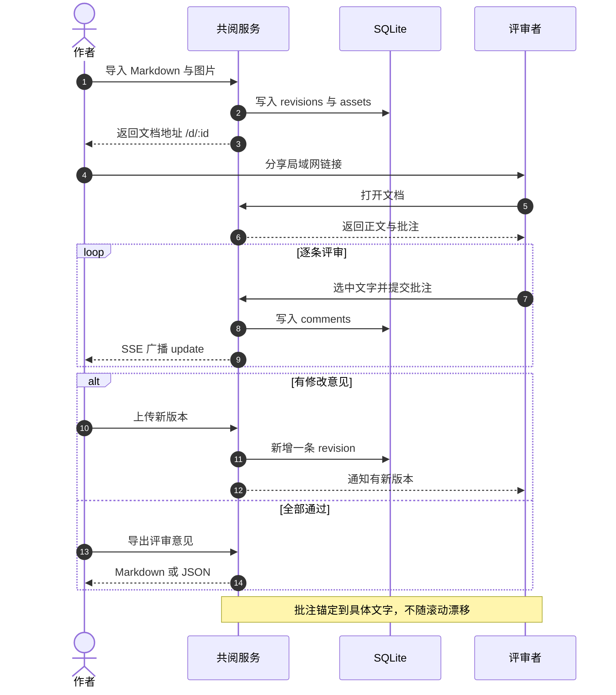
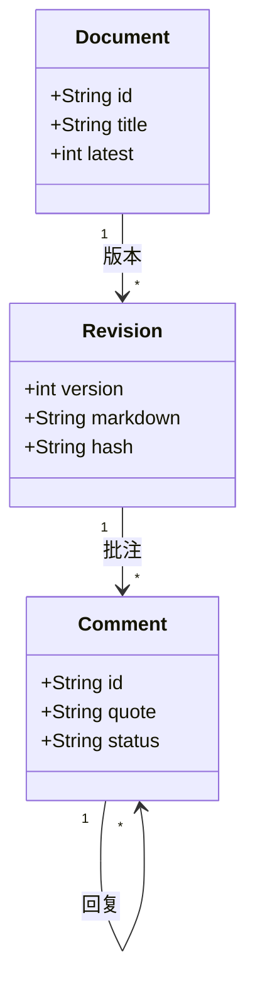

# 共阅 · Markdown 全语法测试

> 这份文档用来验证「共阅」的渲染管线：从 Markdown 解析、安全过滤、代码高亮，到 Mermaid 图示、图片资源与批注锚定。它同时是一份可以直接交给同事评审的示例材料。


## 一、标题层级

### 1.1 三级标题用于章节

#### 1.2 四级标题用于小节

##### 1.3 五级标题很少用，但必须能渲染

###### 1.4 六级标题是最深的一层

## 二、文字样式

这一段包含 **粗体**、*斜体*、***粗斜体***、~~删除线~~、`行内代码`，以及转义写法 \*这不会变成斜体\*。中英文混排时，标点应当保持原有形状，例如「直角引号」和“弯引号”，破折号——以及省略号……都要正常显示。

行内代码 `const answer = 42` 里的星号和下划线不会被当成强调符号，`**not bold**` 应当原样显示。下划线写法 _这也算斜体_ 与双下划线 __这也算粗体__ 同样要生效。

## 三、段落、换行与分隔线

这是第一段。段落之间用空行分隔，渲染结果应当是彼此独立的段落元素。

这一段演示行尾两个空格带来的硬换行：  
第二行从这里开始，前面有两个空格。

这一段演示反斜杠换行：\
换行之后在视觉上另起一行，但语义上仍属于同一个段落。

---

上面是一条分隔线，语义上对应一条水平线；它上下都应当留有间距，不应紧贴正文。

## 四、列表

无序列表支持三种标记，渲染结果应当一致：

- 用减号开头的条目
- 第二个条目，包含 **加粗** 与 `代码`
  - 嵌套一层，缩进两个空格
    - 再嵌套一层，缩进四个空格
- 第三个条目

用星号与加号开头的写法同样有效：

* 星号条目一
* 星号条目二

+ 加号条目

有序列表：

1. 第一步：导入文档
2. 第二步：分享链接
   1. 复制局域网地址
   2. 发给同事
3. 第三步：收集意见

任务列表（应用在渲染时会把方括号换成只读复选框）：

- [x] 支持划词批注
- [x] 支持回复讨论
- [x] 支持按版本隔离批注
- [ ] 支持把批注导出成 CSV
- [ ] 支持批量标记已解决

## 五、引用

> 单层引用：文档与批注都保存在启动服务的那台电脑上，局域网成员填写姓名即可参与。
>
> 引用内部可以换段，也可以写 **格式** 和 `代码`。

> 外层引用
>> 内层引用，嵌套两层
>>> 第三层引用，用来测试左侧竖线的缩进层次

## 六、表格

| 语法 | 写法 | 渲染结果 |
| :--- | :---: | ---: |
| 强调 | `**文字**` | **粗体** |
| 删除线 | `~~文字~~` | ~~删除线~~ |
| 行内代码 | `` `code` `` | `code` |
| 链接 | `[文字](url)` | [示例](https://example.com) |

第二张表测试对齐与空单元格：

| 名称 | 说明 | 备注 |
| :--- | :--- | :--- |
| 对齐 | 左、中、右三种对齐 | 正常 |
| 空单元格 |  | 右侧为空 |
| 长内容 | 单元格里放一段比较长的说明文字，用来观察换行之后行高是否一致 | 观察 |

## 七、代码

行内代码：`pnpm build`、`node server.mjs`。

JavaScript 围栏：

```js
const review = { document: '方案.md', version: 1 };
function anchor(text, quote) {
  const index = text.indexOf(quote);
  return index >= 0 ? index : -1;
}
console.log(anchor('# 方案\n\n这一段需要讨论。', '需要讨论'));
```

JSON：

```json
{
  "schema": "lan-review/1",
  "document": { "id": "doc-id", "version": 1 },
  "comments": [{ "quote": "选中原文", "status": "open" }]
}
```

Shell：

```bash
pnpm install
pnpm build
pnpm start
```

缩进式代码块（每行前面四个空格）：

    function indented() {
      return 'four spaces';
    }

## 八、链接

- 行内链接：[共阅的仓库](https://github.com/jhj1234jhj/lan-markdown-review "GitHub 仓库")
- 自动链接：<https://github.com/jhj1234jhj/lan-markdown-review>
- 引用式链接：[共阅仓库][repo]，以及 [Hypothesis 锚定组件][hyp]
- 裸网址：https://example.com

[repo]: https://github.com/jhj1234jhj/lan-markdown-review "仓库地址"
[hyp]: https://github.com/hypothesis/client "锚定组件来源"

## 九、图片

正文中的第二张图，与封面引用同一份资源，用来验证多图引用与资源复用：


替代文本与图片标题都应当保留；图片按需懒加载，宽度不超出正文栏。

## 十、Mermaid 图示

### 10.1 UML 时序图



### 10.2 UML 类图



### 10.3 流程图


## 十一、边界与不支持的语法

原始 HTML 会被转义成纯文本而不是执行：<div class="danger">这段 HTML 应当以文字形式显示</div>。

脚注语法不在默认插件里，这里写一个脚注引用[^1]，它应当原样显示出来。

数学公式同理：$E = mc^2$ 不会渲染成公式，只为确认不会导致整段渲染失败。

超长连续字符串用于测试布局是否被撑破：aaaaaaaaaaaaaaaaaaaaaaaaaaaaaaaaaaaaaaaaaaaaaaaaaaaaaaaaaaaaaaaaaaaaaaaaaaaaaaaaaaaaaaaaaaaaaaaa。

Emoji 与符号：🎉 ✅ ⚠️ ★ ☆ → ← ↑ ↓ ① ② ③。

## 十二、长文：为什么要做一次全语法测试

渲染器本质上是一层翻译：把 Markdown 文本翻译成浏览器能理解的文档结构。翻译层的问题往往不会以报错的形式出现，而是安静地丢内容——一个没被识别的表格、一段被当成普通文字的代码、一张路径没被改写的图片，都可能让评审者在完全没有察觉的情况下读到残缺的文档。全语法测试的价值就在于此：它用一份刻意覆盖全部语法的文档，把「静默丢失」变成肉眼可见的差异。

测试的目的不是炫技，而是建立基线。这份文档里每一条语法都对应一个可以断言的渲染结果：六级标题必须有六级标题的字号，删除线必须真的有一条横线，任务列表必须出现复选框，表格的右对齐列必须贴右。以后升级 markdown-it、DOMPurify、highlight.js 或 Mermaid，甚至只是调整一段 CSS，都可以重新导入这份文档，逐屏对比，看有没有哪一条退化。没有基线的时候，退化只能靠用户抱怨才能发现；有了基线，退化在发布前就能被拦住。

具体到共阅，渲染层还承担着批注锚定的责任。每一条批注都记录了选中文字本身、它的前后文，以及它在渲染结果里的字符区间；而渲染层会为标题、段落、代码块和列表项写上源文件行号，作为导出意见时的参考位置。这意味着渲染层一旦改变了节点结构或文字顺序，锚点就可能整体偏移。把长文、嵌套列表、表格、代码块、图示混在同一份文档里，正好可以检验：跨越行内元素选中的中文能不能稳定还原，重复出现的句子会不会锚错位置，图片和图示会不会打断文字顺序。

换一个角度，这份文档也可以当作评审流程的演练材料。假设它是一位同事写的方案：有人在第三节圈出硬换行的写法，说这种依赖行尾空格的排版太脆弱；有人在第六节指出表格最后一列没对齐；有人在第八节要求把裸网址换成带说明的链接；还有人直接在时序图下面留言，问「上传新版本」这一步失败时该怎么回滚。这些意见会以批注、回复、已解决三种状态沉淀下来，最后导出一份 Markdown 交给作者。整条链路——导入、分享、批注、讨论、版本、导出——都能在这一份文档上走完。

验收时建议按下面的顺序看一遍：标题从一级到六级逐级缩减；粗体、斜体、粗斜体、删除线、行内代码各自成形；分隔线上下留白均匀；三种无序列表标记渲染一致，嵌套层级缩进递增；有序列表的序号连续，嵌套列表另起编号；任务列表的勾选状态与源码一致；引用支持多层嵌套；两张表格的对齐方式正确，空单元格不塌陷；四个代码块都有高亮，缩进式代码块保持原样；行内、自动、引用式三类链接都能跳转；两张图片都能加载且不变形；三张 Mermaid 图都能渲染成 SVG；转义字符、超长字符串、Emoji 都不破坏布局。

同时也明确记录已知的限制：原始 HTML 会被转义，这是安全策略的一部分，不是缺陷；脚注、数学公式、自动生成目录都不在默认支持范围内，其中目录由应用自己根据标题生成并显示在左侧；外链图片受内容安全策略限制，只有随文档导入的本地图片会被改写成服务端资源地址。把不支持的部分写清楚，比假装支持更有用，因为评审者不会对着一处「看起来怪怪的」渲染结果反复猜测。

最后是体积与性能。这份文档约三千字，含一张八十多 KB 的 JPEG 与三张图示，导入后应当在一秒内渲染完成；Markdown 正文上限两 MB，图片合计上限八 MB，超过就会被服务端拒绝。图示是按需加载的，只有出现 mermaid 代码块时才会下载对应的渲染器。滚动长文时批注高亮不应闪烁，切换版本时正文与批注要一起换掉。做到这些，这份测试文档才算真正通过。
